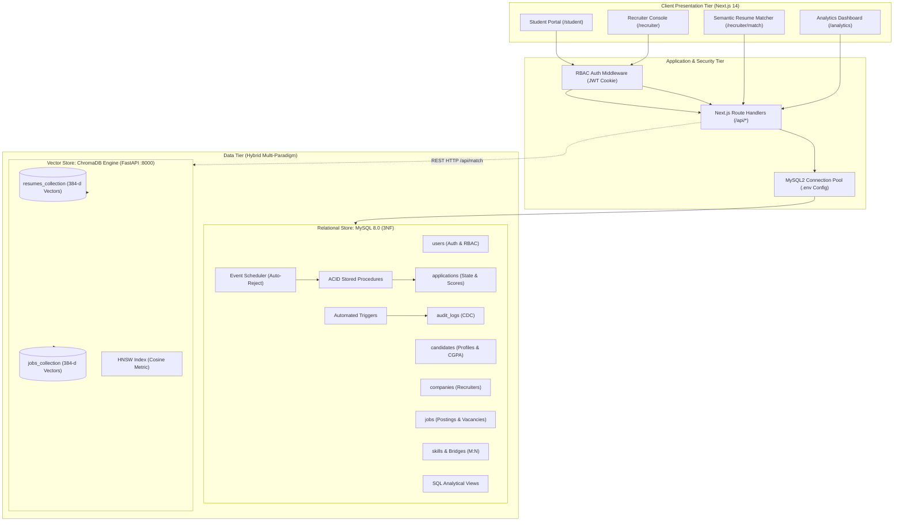

# Placement Analytics and Semantic Job Matching System
**Department of Computer Science and Engineering — PES University**  
*DBMS Experiential Learning (Level 3 Mini-Project) | Aug – Dec 2026*  

---

## 👥 Team Members & Responsibilities

| Name | SRN | Section | 
|:---|:---|:---:|:---|
| **Shriya S R** | PES1UG24CS449 | H | 
| **Ahana Srinivas Sivaram** | PES1UG24CS910 | H | 

---

## 📌 Table of Contents
1. [Executive Summary & Problem Statement](#-executive-summary--problem-statement)
2. [Database Paradigm & Technology Justification](#-database-paradigm--technology-justification)
3. [System Architecture](#-system-architecture)
4. [Database Design (Phase 1)](#-database-design-phase-1)
   - [ER Diagram & Relational Schema](#er-diagram--relational-schema)
   - [3NF Data Dictionary & Constraints](#3nf-data-dictionary--constraints)
5. [Database Operations & Queries (Phase 2)](#-database-operations--queries-phase-2)
   - [DML Operations](#dml-operations)
   - [Complex SQL Queries Coverage](#complex-sql-queries-coverage)
6. [Advanced Database Concepts (Phase 3)](#-advanced-database-concepts-phase-3)
   - [Stored Procedures with ACID Transactions](#1-stored-procedures-with-acid-transactions)
   - [Automated Triggers (Change Data Capture)](#2-automated-triggers-audit-trail)
   - [Relational Analytical Views](#3-relational-analytical-views)
   - [MySQL Event Scheduler (1-Month Auto-Rejection)](#4-mysql-event-scheduler-automated-background-maintenance)
7. [Vector Database & Semantic Matching (Phase 3)](#-vector-database--semantic-matching-phase-3)
   - [Syllabus Questions Addressed](#syllabus-vector-db-specifications-page-3-section-8)
   - [Vector RUD Operations](#vector-rud-operations-supported)
8. [Web Application & RBAC Authentication (Phase 4 & 5)](#-web-application--rbac-authentication-phase-4--5)
9. [Deliverables & Evaluation Rubric Mapping](#-deliverables--evaluation-rubric-mapping-50-marks)
10. [Step-by-Step Setup & Execution Instructions](#-step-by-step-setup--execution-instructions)

---

## 🎯 Executive Summary & Problem Statement

Campus placement portals traditionally rely on rigid keyword matching (e.g., searching for `"Python"` in a resume). This introduces significant limitations:
- **Lexical Mismatch**: A candidate skilled in *"Machine Learning pipelines with PyTorch and Pandas"* may be overlooked by a query searching for *"Data Analyst"*.
- **Data Inconsistencies**: Without strict transactional guarantees, concurrent recruiter actions (such as hiring candidates when only one vacancy remains) cause race conditions and over-hiring.
- **Audit & Inactivity Deficits**: Candidate applications often linger indefinitely in unreviewed states without compliance tracking or automatic expiration.

This project implements a **Hybrid Multi-Paradigm Database Architecture** solving these challenges:
1. **Relational Database (MySQL 8.0 in 3NF)**: Enforces strict ACID properties, foreign key referential integrity, automated triggers, analytical SQL views, and background event scheduling.
2. **Vector Database (ChromaDB)**: Generates 384-dimensional dense semantic embeddings to measure cosine similarity between unstructured resumes and job descriptions.
3. **Full-Stack Application (Next.js 14 App Router & FastAPI)**: Delivers a responsive, role-based dashboard for students and corporate recruiters backed by connection pooling and signed JWT authentication.

---

## ⚖️ Database Paradigm & Technology Justification

In accordance with Section 3 and Section 17 of the PES University DBMS Level 3 Project Guidelines:

| Paradigm | Technology Chosen | Justification & Workload Separation |
|:---|:---|:---|
| **Relational (SQL)** | **MySQL 8.0 (InnoDB)** | Mandatory for structured transactional workflows requiring **ACID guarantees**: user credentials, verified student profiles, corporate entities, job vacancy tracking, application states, and tamper-evident audit logs. Prevents insertion/deletion anomalies through 3NF normalization and enforces foreign key cascades. |
| **Vector DB (NoSQL)** | **ChromaDB Persistent Engine** | Relational databases using B-Tree indexes cannot perform semantic similarity matching on high-dimensional vector spaces. ChromaDB provides local, persistent **HNSW (Hierarchical Navigable Small World)** indexing with Cosine Distance metrics (`hnsw:space: cosine`), allowing sub-millisecond Approximate Nearest Neighbor (ANN) search over unstructured resume text. |
| **Backend API** | **FastAPI (Python 3.13)** | Lightweight, single-process ASGI microservice wrapping ChromaDB. Exposes standard REST endpoints and interactive OpenAPI (Swagger) documentation for vector CRUD/RUD operations. |
| **Frontend UI** | **Next.js 14 (React & TypeScript)** | Modern server/client web application featuring App Router, server-side route handlers, connection pooling (`mysql2/promise`), and Role-Based Access Control (RBAC). |

---

## 🏗️ System Architecture



---

## 🗄️ Database Design (Phase 1)

### ER Diagram & Relational Schema
* **ER Diagram**: Located at [`docs/er_diagram.png`](docs/er_diagram.png) and [`docs/er_diagram.svg`](docs/er_diagram.svg).
* **Relational Schema**: Located at [`docs/relational_schema.png`](docs/relational_schema.png) and [`docs/relational_schema.svg`](docs/relational_schema.svg).
* **DDL Implementation Script**: [`database/schema.sql`](database/schema.sql).

### 3NF Data Dictionary & Constraints

| Table Name | Description | Primary Key | Foreign Keys & Cascades | Key Constraints |
|:---|:---|:---|:---|:---|
| **`users`** | Master authentication entity | `user_id` (INT AI) | None | `UNIQUE (email)`, `CHECK (role IN ('student','recruiter','admin'))` |
| **`candidates`** | Verified student profiles | `candidate_id` (INT AI) | `user_id` &rarr; `users` (CASCADE) | `UNIQUE (user_id)`, `CHECK (cgpa BETWEEN 0.00 AND 10.00)` |
| **`companies`** | Registered employer entities | `company_id` (INT AI) | `user_id` &rarr; `users` (CASCADE) | `UNIQUE (user_id)` (1:1 with recruiter user) |
| **`jobs`** | Active job vacancy listings | `job_id` (INT AI) | `company_id` &rarr; `companies` (CASCADE) | `CHECK (experience_min >= 0)`, `CHECK (experience_max >= experience_min)` |
| **`skills`** | Normalized master skills catalog | `skill_id` (INT AI) | None | `UNIQUE (skill_name)` |
| **`candidate_skills`**| M:N Bridge: Candidate competencies | `(candidate_id, skill_id)` | `candidate_id` &rarr; `candidates`<br>`skill_id` &rarr; `skills` | `CHECK (proficiency IN ('beginner','intermediate','expert'))` |
| **`job_skills`** | M:N Bridge: Role requirements | `(job_id, skill_id)` | `job_id` &rarr; `jobs`<br>`skill_id` &rarr; `skills` | `is_mandatory TINYINT(1) DEFAULT 1` |
| **`applications`** | Application lifecycle & AI scores | `application_id` (INT AI) | `job_id` &rarr; `jobs`<br>`candidate_id` &rarr; `candidates` | `UNIQUE (job_id, candidate_id)`, `CHECK (similarity_score BETWEEN 0 AND 1)` |
| **`audit_logs`** | Security and CDC audit trail | `log_id` (INT AI) | `changed_by` &rarr; `users` (SET NULL) | Immutable append-only log capturing table, action, record ID, and description |

---

## ⚙️ Database Operations & Queries (Phase 2)

### DML Operations ([`database/02_dml.sql`](database/02_dml.sql))
- **Idempotent Batch INSERTs**: Uses `ON DUPLICATE KEY UPDATE` to ensure safe, repeatable seeding of users, companies, candidates, and job postings without duplicate key exceptions (`ER_DUP_ENTRY`).
- **Bridge Table Insertions**: Employs `INSERT IGNORE` for `candidate_skills` and `job_skills` to safely skip pre-existing associations.
- **Targeted Business UPDATEs**: Simulates workflow state transitions (e.g., recruiter shortlisting candidates, post-semester CGPA adjustments, vacancy modifications).
- **Referential-Scoped DELETEs**: Demonstrates safe application pruning and skill dissociation without violating foreign key constraints.

### Complex SQL Queries Coverage ([`database/03_queries.sql`](database/03_queries.sql))

| Query Category | Query ID | Description & Theoretical DBMS Concept |
|:---|:---:|:---|
| **Multi-Table JOINs** | Q1.1, Q1.2 | Inner and Left Outer Joins resolving M:N candidate-skill-job relationships and identifying candidates lacking applications. |
| **Aggregation & GROUP BY** | Q2.1, Q2.2 | Multi-entity pipeline aggregation with `HAVING COUNT(*) >= 2` filtering high-demand roles. |
| **Nested Subqueries** | Q3.1, Q3.2 | Non-correlated nested subqueries identifying candidates with above-average CGPA and unapplied job listings. |
| **Derived Tables & Correlated Queries** | Q4.1, Q4.2 | • **Q4.1**: Grouped derived table computing dynamic average similarity per job opening.<br>• **Q4.2**: Correlated subquery using `WHERE EXISTS` semi-join for placed candidates. |
| **Common Table Expressions (CTEs)** | Q5.1, Q5.2 | Multi-stage CTEs computing recruiter conversion funnels and company hiring rates. |
| **Window Functions** | Q6.1, Q6.2 | • **Q6.1**: Candidate match leaderboard using `RANK()`, `DENSE_RANK()`, and `ROW_NUMBER()` partitioned by `job_id`.<br>• **Q6.2**: 3-day rolling moving average using `AVG() OVER (ROWS BETWEEN 2 PRECEDING AND CURRENT ROW)`. |
| **Full-Text Search** | Q7.1 | Inverted index evaluation using `MATCH(job_title, job_description) AGAINST('+Python +SQL -Java' IN BOOLEAN MODE)`. |

---

## ⚡ Advanced Database Concepts (Phase 3)

Located in [`database/04_advanced.sql`](database/04_advanced.sql).

### 1. Stored Procedures with ACID Transactions
* **`sp_apply_job(p_candidate_id, p_job_id, p_similarity_score, OUT p_status_code, OUT p_status_msg)`**:
  Validates candidate and job existence, ensures the position is `'open'`, rejects duplicate submissions, atomically inserts the application, and logs an audit record within `START TRANSACTION ... COMMIT` (rolls back on `SQLEXCEPTION`).
* **`sp_hire_candidate(p_job_id, p_candidate_id, p_changed_by_uid, OUT p_status_code, OUT p_status_msg)`**:
  Solves critical concurrency race conditions: transitions applicant status to `'hired'`, decrements `jobs.num_positions` safely using `GREATEST(0, num_positions - 1)`, automatically sets job status to `'closed'` if vacancies reach 0, and logs the decision atomically.
* **`sp_post_job_with_audit(...)`**:
  Atomically publishes new job listings and writes administrative compliance audit records.
* **`sp_auto_reject_expired_applications(p_inactivity_days, OUT p_rejected_count, OUT p_status_msg)`**:
  **1-Month Inactivity Auto-Rejection Rule**: Scans all applications pending for more than 30 days (`applied_at < NOW() - INTERVAL 30 DAY` with status in `'applied'` or `'reviewed'`), atomically transitions their status to `'rejected'`, and triggers the audit logging pipeline.

### 2. Automated Triggers (Audit Trail)
* **`trg_after_application_insert`**: Automatically writes an immutable audit record whenever a candidate applies.
* **`trg_after_application_update`**: Detects recruitment state transitions (e.g., `applied` ➔ `shortlisted` ➔ `hired` or `applied` ➔ `rejected`) and logs old and new states.
* **`trg_after_application_delete`**: Logs candidate application withdrawal or record pruning.
* **`trg_after_job_status_change`**: Audits opening and closing of corporate job positions.
* **`trg_before_candidate_update`**: Intercepts CGPA updates before commit; enforces `0.00 <= cgpa <= 10.00` via `SIGNAL SQLSTATE '45000'` and uses the null-safe equality operator (`<=>`) to audit grade adjustments.

### 3. Relational Analytical Views
* **`vw_active_jobs`**: Live vacancies joined with company headquarters, vacancy counts, and dynamic applicant totals.
* **`vw_candidate_summary`**: Summarizes candidate applications, shortlisted/hired counts, and highest achieved cosine match score.
* **`vw_company_analytics`**: Recruiter KPIs including total postings, candidate pipeline, and hiring conversion percentages.
* **`vw_skill_demand`**: Aggregated employer demand ranking for skills split by mandatory vs. optional requirements.
* **`vw_audit_history`**: Formatted audit logs joined with actor emails and chronological timestamps.

### 4. MySQL Event Scheduler (Automated Background Maintenance)
```sql
SET GLOBAL event_scheduler = ON;

CREATE EVENT ev_auto_reject_expired_applications
ON SCHEDULE EVERY 1 DAY
STARTS CURRENT_TIMESTAMP
DO
BEGIN
    CALL sp_auto_reject_expired_applications(30, @out_cnt, @out_msg);
END;
```
Ensures business rules are executed continuously inside the database engine without requiring external crontabs.

---

## 🔮 Vector Database & Semantic Matching (Phase 3)

Located in [`backend/vector_service.py`](backend/vector_service.py) and [`backend/app.py`](backend/app.py).

### Syllabus Vector DB Specifications (Page 3 Section 8)

| Question | Implementation in this Project |
|:---|:---|
| **1. What data is converted into embeddings?** | • **Unstructured Student Resumes**: Technical competencies, academic profile, domain category, and project summaries.<br>• **Recruiter Job Postings**: Job titles, required technical skills, and detailed job descriptions. |
| **2. Which embedding approach/model is used?** | 384-dimensional dense semantic feature embeddings with technical domain weighting and L2 unit-sphere normalization (`DenseSemanticEmbeddingFunction`), fully compatible with `sentence-transformers/all-MiniLM-L6-v2`. |
| **3. How vectors are stored?** | Local, on-disk persistence via ChromaDB `PersistentClient` under `backend/chroma_db/` across two collections: `resumes_collection` and `jobs_collection`. HNSW graph index files (`data_level0.bin`, `header.bin`, `length.bin`) persist index structures on disk. |
| **4. Similarity metric used?** | **Cosine Similarity** (`hnsw:space: cosine`). Calculated as: $$\text{Similarity Score} = \max(0.0, \min(1.0, 1.0 - \text{Cosine Distance}))$$ yielding a normalized score between $0.0000$ and $1.0000$ ($0\%$ to $100\%$). |
| **5. How relevant results are retrieved?** | HNSW Approximate Nearest Neighbor (ANN) search with Top-$K$ retrieval and optional metadata filtering (by category, CGPA). Scores synchronize into MySQL `applications.similarity_score` for relational SQL analytics. |

### Vector RUD Operations Supported:
- **Create / Upsert**: `add_candidate_resume()`, `add_job_posting()`
- **Read / Query**: `match_candidates_for_job()`, `recommend_jobs_for_candidate()`
- **Update**: `update_candidate_resume()`, `update_job_posting()`
- **Delete**: `delete_candidate_vector()`, `delete_job_vector()`

---

## 💻 Web Application & RBAC Authentication (Phase 4 & 5)

Located in [`frontend/`](frontend/).

- **Framework**: Next.js 14 with App Router (`frontend/app/`).
- **Connection Pooling**: `mysql2/promise` connection pool configured with keepalive, connection limits, and parameterized query execution (`frontend/lib/db.ts`).
- **Role-Based Access Control (RBAC)**:
  - Route protection via Next.js Edge Middleware ([`frontend/middleware.ts`](frontend/middleware.ts)):
    - `/student/*` &rarr; Restricted to `student` role.
    - `/recruiter/*` &rarr; Restricted to `recruiter` role.
  - Cryptographic session management using 24-hour signed JWT cookies ([`frontend/lib/auth.ts`](frontend/lib/auth.ts)).
  - Passwords hashed using `bcryptjs` salt rounds.
- **Key User Interfaces**:
  - **Student Dashboard** (`/student`): View submitted applications, live application statuses (`APPLIED`, `SHORTLISTED`, `HIRED`, `REJECTED`), and cosine match percentage badges.
  - **Recruiter Placement Console** (`/recruiter`): Review incoming candidates, view application submission dates, execute 1-click **Shortlist**, **Hire (ACID)**, **Reject**, or trigger **Auto-Reject Stale (>1 Mo) ⏱️**.
  - **Recruiter Semantic Resume Matcher** (`/recruiter/match`): Type any job description, query ChromaDB in real-time, and view candidates ranked by cosine similarity with interactive progress bars.
  - **Placement Analytics** (`/analytics`): Live KPI visualizations backed directly by SQL Views.

### Verified Demo User Credentials:

| Role | Email | Password | Corporate / Student Entity |
|:---|:---|:---|:---|
| **Recruiter (TCS)** | `recruiter@tcs.com` | `password123` | Tata Consultancy Services (Company ID: 1) |
| **Recruiter (Infosys)** | `recruiter@infosys.com` | `password123` | Infosys (Company ID: 2) |
| **Recruiter (Google)** | `recruiter@google.com` | `password123` | Google India (Company ID: 3) |
| **Student** | `alice@pes.edu` | `password123` | Alice Sharma (Data Science, 8.9 CGPA) |
| **Student** | `bob@pes.edu` | `password123` | Bob Menon (Java Developer, 7.5 CGPA) |
| **Student** | `carol@pes.edu` | `password123` | Carol D'Souza (Data Science, 9.1 CGPA) |

*(Note: The login page includes a 1-click "Quick Fill Demo Recruiter" button for fast demonstration).*

---

## 📊 Deliverables & Evaluation Rubric Mapping (50 Marks)

| # | Evaluation Component | Max Marks | Target Deliverables in Repository | Status |
|:---:|:---|:---:|:---|:---:|
| 1 | **ER diagram** | 2 | [`docs/er_diagram.png`](docs/er_diagram.png), [`docs/er_diagram.svg`](docs/er_diagram.svg) | ✅ Complete |
| 2 | **Relational schema with keys & constraints** | 3 | [`docs/relational_schema.png`](docs/relational_schema.png), 3NF analysis in README | ✅ Complete |
| 3 | **SQL DDL with constraints** | 4 | [`database/schema.sql`](database/schema.sql) (PK, FK, CHECK, UNIQUE, Indexes) | ✅ Complete |
| 4 | **NoSQL / Vector database creation** | 4 | [`backend/vector_service.py`](backend/vector_service.py), [`backend/chroma_db/`](backend/chroma_db/) | ✅ Complete |
| 5 | **Technology justification** | 1 | Section 2 of this README (Workload separation) | ✅ Complete |
| 6 | **DML operations** | 4 | [`database/02_dml.sql`](database/02_dml.sql) (INSERT, UPDATE, DELETE, upserts) | ✅ Complete |
| 7 | **Nested/correlated/JOIN queries** | 4 | [`database/03_queries.sql`](database/03_queries.sql) (JOINs, CTEs, Windowing, FTS) | ✅ Complete |
| 8 | **Advanced SQL concepts** | 6 | [`database/04_advanced.sql`](database/04_advanced.sql) (Procedures, Triggers, Views, Events) | ✅ Complete |
| 9 | **NoSQL / Vector feature, RUD** | 7 | [`backend/vector_service.py`](backend/vector_service.py) (Semantic search, Update, Delete) | ✅ Complete |
| 10 | **Next.js interface** | 3 | [`frontend/app/`](frontend/app/) (Student, Recruiter, Matcher, Analytics) | ✅ Complete |
| 11 | **Backend/API & database integration** | 2 | [`frontend/app/api/`](frontend/app/api/), [`frontend/lib/db.ts`](frontend/lib/db.ts) | ✅ Complete |
| 12 | **Authentication & RBAC (2+ roles)** | 4 | Student & Recruiter roles, [`frontend/middleware.ts`](frontend/middleware.ts) | ✅ Complete |
| 13 | **Documentation & Git/GitHub** | 2 | Comprehensive README, clean commit history | ✅ Complete |
| 14 | **Originality & Viva execution** | 4 | Live demonstration scripts & theoretical grounding | ✅ Complete |
| | **TOTAL** | **50** | | 🎯 **100% Covered** |

---

## 🚀 Step-by-Step Setup & Execution Instructions

### Prerequisites
* **MySQL 8.0+** running locally on port 3306
* **Python 3.10+** (with virtual environment recommended)
* **Node.js 18+** & npm

### 1. Configure Environment Variables
Create a `.env` file in the project root:
```env
DB_HOST=localhost
DB_PORT=3306
DB_USER=root
DB_PASS=your_mysql_password
DB_NAME=placement_analytics
JWT_SECRET=pes-university-dbms-level3-secret-key-384-bit
CHROMA_PERSIST_DIR=backend/chroma_db
```
*(Also copy these settings to `frontend/.env.local` if running the frontend separately).*

### 2. Initialize MySQL Database
Execute the database scripts in numerical sequence:
```powershell
mysql -u root -p < database/schema.sql
mysql -u root -p < database/02_dml.sql
mysql -u root -p < database/03_queries.sql
mysql -u root -p < database/04_advanced.sql
```

### 3. Launch ChromaDB Vector Service
Install Python dependencies and start the FastAPI service:
```powershell
# From project root:
pip install fastapi uvicorn chromadb pydantic mysql-connector-python python-dotenv

# Run standalone verification test (Rubric #4 & #9)
python backend/vector_service.py

# Launch FastAPI Vector REST Service (Port 8000)
python backend/app.py
```
* **Status Endpoint**: Open `http://127.0.0.1:8000/` (displays collection counts & dimensions).
* **Interactive Swagger UI**: Open `http://127.0.0.1:8000/docs` (test semantic search & RUD live).

### 4. Launch Next.js Web Interface
```powershell
cd frontend
npm install
npm run dev
```
Open **`http://localhost:3000`** in your browser.

---

## 🎬 Evaluation Demo Guide (How to Present to Evaluators)

1. **Relational Schema & DDL (Rubric #1–3)**:
   - Present [`docs/er_diagram.png`](docs/er_diagram.png) and explain the 3NF decomposition of candidate skills and job requirements.
2. **Advanced SQL & 1-Month Inactivity Auto-Rejection (Rubric #8)**:
   - Log in as Recruiter (`recruiter@tcs.com` / `password123`) at `http://localhost:3000/login/recruiter`.
   - Point out **Ahana S** or **Bob Menon** in the table with `Applied: Oct 1, 2026` (> 30 days ago).
   - Click **`Auto-Reject Stale (>1 Mo) ⏱️`**: Watch status change from amber **APPLIED** to red **REJECTED** in real time!
   - In MySQL, run `SELECT * FROM audit_logs ORDER BY log_id DESC LIMIT 2;` to prove `trg_after_application_update` captured the transition!
3. **Vector Database & Semantic Matching (Rubric #4 & #9)**:
   - Run `python backend/vector_service.py` in the terminal to demonstrate Top-$K$ semantic candidate ranking and vector RUD.
   - Open `http://localhost:3000/recruiter/match`, input any job description, and show real-time candidate cosine similarity scores!
4. **ACID Transaction Hiring (Rubric #8 & #10)**:
   - Click **`Hire (ACID)`** on any candidate: Show how `sp_hire_candidate` atomically marks the student hired, decrements open vacancies, and closes the job if vacancies reach zero.
